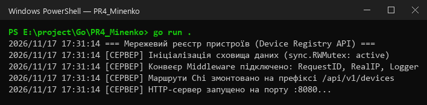
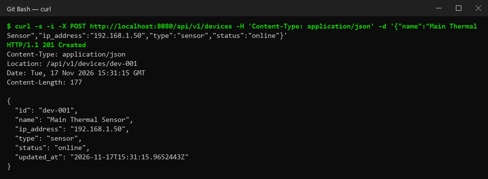
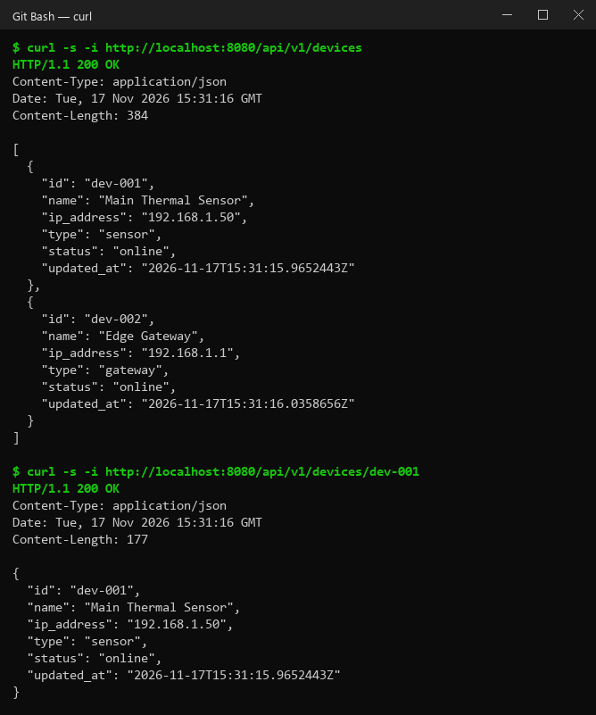
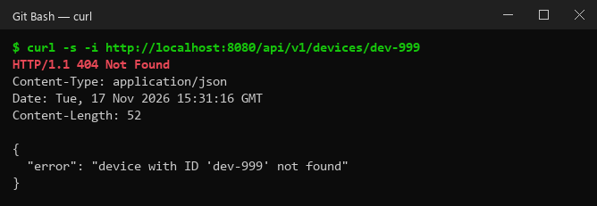
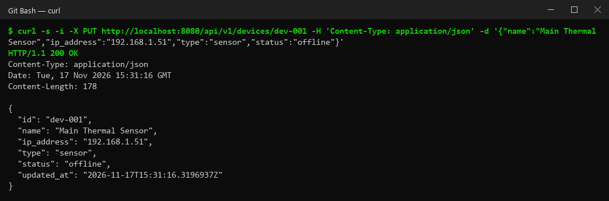
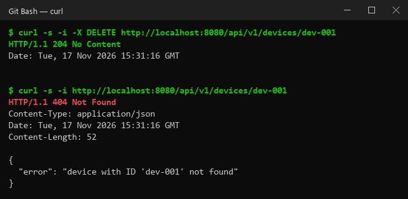
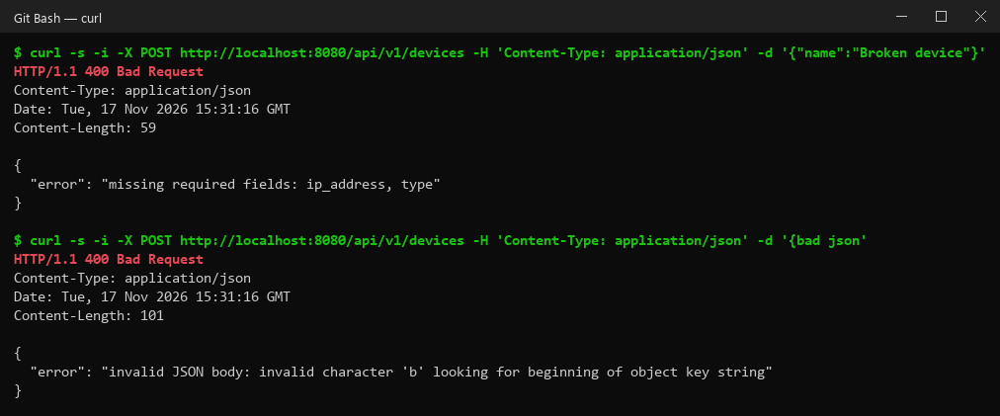
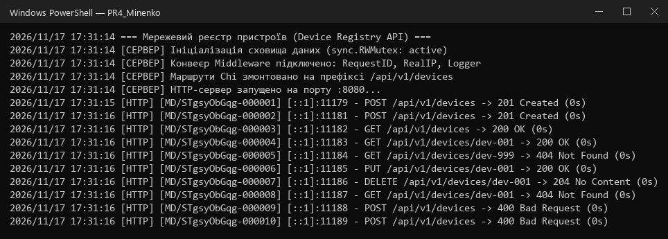
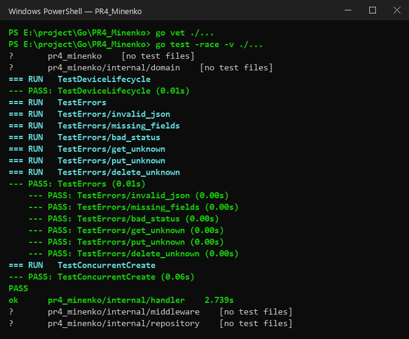

# Практична робота № 4
## Тема: Побудова REST API з використанням маршрутизатора Chi
### (Реалізація: Рівень 1 та Рівень 2)

---

## Зміст
1. [Мета роботи](#мета-роботи)
2. [Опис реалізованої системи (Рівні 1 та 2)](#опис-реалізованої-системи-рівні-1-та-2)
3. [Структура проєкту](#структура-проєкту)
4. [Опис REST API](#опис-rest-api)
5. [Покрокова інструкція із запуску](#покрокова-інструкція-із-запуску)
6. [Скріншоти роботи програми](#скріншоти-роботи-програми)
7. [Відповіді на контрольні питання](#відповіді-на-контрольні-питання)
8. [Висновок](#висновок)

---

## Мета роботи
- Опанувати принципи проєктування REST API з дотриманням семантики HTTP-методів, ідемпотентності та стандартизованих кодів стану.
- Набути практичних навичок роботи з маршрутизатором `go-chi/chi/v5`: суб-роутерами (`r.Route`, `r.Mount`) та параметрами шляху (`chi.URLParam`).
- Засвоїти шарувату архітектуру: доменні моделі (`domain`), потокобезпечне сховище (`repository`) на базі `sync.RWMutex` та HTTP-обробники (`handler`).
- Опанувати конвеєр проміжної обробки запитів (Middleware) для логування.

---

## Опис реалізованої системи (Рівні 1 та 2)

Розроблено вебсервіс **реєстру пристроїв (Device Registry API)** на базі маршрутизатора Chi.

1. **Рівень 1 (Базовий: структура, сховище RWMutex, читання/створення)**:
   - Ініціалізовано Go-модуль `pr4_minenko`, встановлено `github.com/go-chi/chi/v5`.
   - Описано модель `domain.Device` з JSON-тегами: `id`, `name`, `ip_address`, `type`, `status`, `updated_at`.
   - Оголошено інтерфейс `repository.DeviceRepository` та реалізовано `MemoryDeviceRepository` (карта `map[string]domain.Device` + `sync.RWMutex`):
     - `GetAll()` та `GetByID()` — під `RLock()` (паралельне читання);
     - `Create()` — під `Lock()` (ексклюзивний запис).
   - Реалізовано ендпоінти `GET /api/v1/devices`, `POST /api/v1/devices` (валідація `name`, `ip_address`, `type`, генерація ID формату `dev-001`, відповідь `201 Created`) та `GET /api/v1/devices/{id}` (`200 OK` / `404 Not Found`).
   - Сервер слухає порт `:8080`.

2. **Рівень 2 (Ключовий: повний CRUD та Middleware логування)**:
   - Репозиторій розширено методами `Update(id, device) bool` та `Delete(id) bool` (обидва під `Lock()`).
   - `PUT /api/v1/devices/{id}` — повна заміна полів, `updated_at = time.Now()`, `200 OK` або `404 Not Found`.
   - `DELETE /api/v1/devices/{id}` — `204 No Content` без тіла або `404 Not Found`.
   - Підключено конвеєр Middleware: стандартні `middleware.RequestID`, `middleware.RealIP` та власний `Logger` (`internal/middleware/logger.go`), що виводить ID запиту, адресу клієнта, метод, шлях, код статусу та тривалість обробки.
   - Написано автоматичні тести (`internal/handler/device_test.go`): повний життєвий цикл ресурсу, помилкові сценарії та конкурентне створення 50 пристроїв.

---

## Структура проєкту

```text
PR4_Minenko/
├── internal/
│   ├── domain/
│   │   └── device.go          # Модель Device з JSON-тегами
│   ├── repository/
│   │   └── device.go          # Інтерфейс DeviceRepository + MemoryDeviceRepository (sync.RWMutex)
│   ├── handler/
│   │   ├── device.go          # HTTP-обробники CRUD, суб-роутер Chi, валідація
│   │   └── device_test.go     # Тести життєвого циклу, помилок та конкурентності
│   └── middleware/
│       └── logger.go          # Власний Middleware логування запитів
├── png/                       # Скріншоти для звіту
├── main.go                    # Точка входу: роутер, конвеєр Middleware, HTTP-сервер :8080
├── requests.http              # Набір запитів для VS Code REST Client
├── go.mod / go.sum            # Go-модуль (pr4_minenko), залежність chi/v5
└── README.md                  # Документація та звіт
```

---

## Опис REST API

| Метод | Шлях | Опис | Успіх | Помилки |
|-------|------|------|-------|---------|
| `GET` | `/api/v1/devices` | Список усіх пристроїв | `200 OK` | — |
| `POST` | `/api/v1/devices` | Реєстрація нового пристрою | `201 Created` | `400 Bad Request` |
| `GET` | `/api/v1/devices/{id}` | Пристрій за ID | `200 OK` | `404 Not Found` |
| `PUT` | `/api/v1/devices/{id}` | Повне оновлення пристрою | `200 OK` | `400`, `404` |
| `DELETE` | `/api/v1/devices/{id}` | Виведення пристрою з експлуатації | `204 No Content` | `404 Not Found` |

**Тіло запиту POST / PUT:**
```json
{"name":"Main Thermal Sensor","ip_address":"192.168.1.50","type":"sensor","status":"online"}
```
- `name`, `ip_address`, `type` — обов'язкові;
- `status` — `online` або `offline` (якщо не вказано — `offline`);
- `id` та `updated_at` генерує сервер.

**Формат помилки:**
```json
{ "error": "device with ID 'dev-999' not found" }
```

---

## Покрокова інструкція із запуску

### Крок 1. Встановлення залежностей
```powershell
go mod download
```

### Крок 2. Запуск сервера (Термінал № 1)
```powershell
go run .
```
Очікуваний вивід:
```text
=== Мережевий реєстр пристроїв (Device Registry API) ===
[СЕРВЕР] Ініціалізація сховища даних (sync.RWMutex: active)
[СЕРВЕР] Конвеєр Middleware підключено: RequestID, RealIP, Logger
[СЕРВЕР] Маршрути Chi змонтовано на префіксі /api/v1/devices
[СЕРВЕР] HTTP-сервер запущено на порту :8080...
```

### Крок 3. Повний життєвий цикл ресурсу (Термінал № 2)

> У PowerShell використовуйте саме `curl.exe` (а не `curl`, який є псевдонімом `Invoke-WebRequest`). Найпростіше — виконати команди в Git Bash або через файл `requests.http` (розширення REST Client).

**Create:**
```bash
curl -i -X POST http://localhost:8080/api/v1/devices \
  -H "Content-Type: application/json" \
  -d '{"name":"Main Thermal Sensor","ip_address":"192.168.1.50","type":"sensor","status":"online"}'
```
**Read (список та за ID):**
```bash
curl -i http://localhost:8080/api/v1/devices
curl -i http://localhost:8080/api/v1/devices/dev-001
```
**Read неіснуючого (404):**
```bash
curl -i http://localhost:8080/api/v1/devices/dev-999
```
**Update:**
```bash
curl -i -X PUT http://localhost:8080/api/v1/devices/dev-001 \
  -H "Content-Type: application/json" \
  -d '{"name":"Main Thermal Sensor","ip_address":"192.168.1.51","type":"sensor","status":"offline"}'
```
**Delete (204):**
```bash
curl -i -X DELETE http://localhost:8080/api/v1/devices/dev-001
```
**Read після видалення (404):**
```bash
curl -i http://localhost:8080/api/v1/devices/dev-001
```
**Валідація (400):**
```bash
curl -i -X POST http://localhost:8080/api/v1/devices \
  -H "Content-Type: application/json" -d '{"name":"Broken device"}'
```

Журнал сервера після цих запитів:
```text
[HTTP] [MD/STgsyObGqg-000001] [::1]:11179 - POST /api/v1/devices -> 201 Created (0s)
[HTTP] [MD/STgsyObGqg-000002] [::1]:11181 - POST /api/v1/devices -> 201 Created (0s)
[HTTP] [MD/STgsyObGqg-000003] [::1]:11182 - GET /api/v1/devices -> 200 OK (0s)
[HTTP] [MD/STgsyObGqg-000004] [::1]:11183 - GET /api/v1/devices/dev-001 -> 200 OK (0s)
[HTTP] [MD/STgsyObGqg-000005] [::1]:11184 - GET /api/v1/devices/dev-999 -> 404 Not Found (0s)
[HTTP] [MD/STgsyObGqg-000006] [::1]:11185 - PUT /api/v1/devices/dev-001 -> 200 OK (0s)
[HTTP] [MD/STgsyObGqg-000007] [::1]:11186 - DELETE /api/v1/devices/dev-001 -> 204 No Content (0s)
[HTTP] [MD/STgsyObGqg-000008] [::1]:11187 - GET /api/v1/devices/dev-001 -> 404 Not Found (0s)
[HTTP] [MD/STgsyObGqg-000009] [::1]:11188 - POST /api/v1/devices -> 400 Bad Request (0s)
[HTTP] [MD/STgsyObGqg-000010] [::1]:11189 - POST /api/v1/devices -> 400 Bad Request (0s)
```
Тривалість `0s` пояснюється тим, що у Windows монотонний годинник Go оновлюється з кроком системного таймера (від 0,5 до 15,6 мс), а запити до in-memory сховища обробляються швидше. У Linux та macOS для тих самих запитів виводяться мікросекунди (наприклад, `120µs`).

### Крок 4. Автоматичні тести та статичний аналіз
```powershell
go vet ./...
$env:CGO_ENABLED=1; go test -race -v ./...
```
Для `-race` потрібен C-компілятор (у Windows: `gcc` з MSYS2, каталог `C:\msys64\ucrt64\bin` у `PATH`). Без нього тести запускаються командою `go test -v ./...`.

---

## Скріншоти роботи програми

| № | Файл | Що показано |
|---|------|-------------|
| 1 | `1_server_start.png` | Стартові повідомлення сервера, порт `:8080` |
| 2 | `2_create_device.png` | `POST` → `201 Created`, заголовок `Location`, JSON пристрою з `id: dev-001` |
| 3 | `3_get_list_and_by_id.png` | `GET` списку та пристрою за ID → `200 OK` |
| 4 | `4_not_found.png` | `GET .../dev-999` → `404 Not Found` та JSON помилки |
| 5 | `5_update_device.png` | `PUT .../dev-001` → `200 OK`, змінені `ip_address`, `status` та новий `updated_at` |
| 6 | `6_delete_and_404.png` | `DELETE` → `204 No Content` без тіла, повторний `GET` → `404 Not Found` |
| 7 | `7_validation_400.png` | `POST` без обов'язкових полів та з невалідним JSON → `400 Bad Request` |
| 8 | `8_server_logs.png` | Рядки `[HTTP]` з ID запиту, адресою, методом, шляхом, статусом і тривалістю |
| 9 | `9_go_test_passed.png` | `go vet` та `go test -race -v` без помилок |


#### 1. Запуск сервера


#### 2. Створення пристрою (POST → 201)


#### 3. Отримання списку та пристрою за ID (GET → 200)


#### 4. Неіснуючий пристрій (GET → 404)


#### 5. Оновлення пристрою (PUT → 200)


#### 6. Видалення та повторне читання (DELETE → 204, GET → 404)


#### 7. Валідація вхідних даних (POST → 400)


#### 8. Журнал Middleware логування


#### 9. Автоматичні тести


---

## Відповіді на контрольні питання

### 1. Чим відрізняється REST від RPC за принципами адресації та набором операцій?
У **RPC** адресуються *дії* (процедури): `/createDevice`, `/getDeviceById?id=1`, кількість операцій необмежена, а HTTP-метод часто один (POST).
У **REST** адресуються *ресурси* (іменники): `/api/v1/devices/dev-001`, а дії виражаються обмеженим уніфікованим набором HTTP-методів (`GET`, `POST`, `PUT`, `DELETE`). Стан передається у вигляді представлень (JSON), сервер не зберігає стан сесії клієнта (stateless), а результат сигналізується стандартними кодами стану.

### 2. Відмінність між безпечними (safe) та ідемпотентними методами
- **Безпечний** метод не змінює стан сервера (лише читання).
- **Ідемпотентний** метод при багаторазовому повторенні дає той самий стан сервера, що й одноразовий виклик.

| Метод | Safe | Idempotent |
|-------|------|------------|
| `GET` | Так | Так |
| `POST` | Ні | Ні (кожен виклик створює новий пристрій) |
| `PUT` | Ні | Так (повторна заміна дає той самий результат) |
| `DELETE` | Ні | Так (після першого видалення ресурсу вже немає — стан не змінюється, хоча код відповіді може бути 404) |

Будь-який безпечний метод є ідемпотентним, але не навпаки.

### 3. Переваги Chi над `http.ServeMux`. Що таке Radix Tree?
Chi надає: суб-роутери та групи (`Route`, `Mount`, `Group`) зі спільними префіксами та власними Middleware; параметри шляху з регулярними виразами (`{id:[0-9]+}`); набір готових Middleware (`Logger`, `RequestID`, `RealIP`, `Recoverer`, `Timeout`); автоматичні `405 Method Not Allowed`; при цьому повну сумісність з `net/http` (`http.Handler`). Стандартний `ServeMux` з Go 1.22 вміє методи та `{id}`, але не має вкладених роутерів і стеку Middleware.
**Radix Tree** (стиснене префіксне дерево) — дерево, де вузли зберігають спільні префікси шляхів (`/api/v1/devices` → `/` або `/{id}`). Пошук маршруту виконується за час, пропорційний довжині URL, а не кількості маршрутів.

### 4. Чому потрібен `sync.RWMutex`, а не `sync.Mutex` чи незахищена карта?
`net/http` обробляє кожен запит в окремій горутині. Одночасне читання та запис у звичайну `map` призводить до фатальної помилки рантайму `concurrent map read and map write`, яку неможливо перехопити `recover()`. `sync.Mutex` вирішує проблему, але серіалізує *всі* операції, навіть читання. `sync.RWMutex` дозволяє необмеженій кількості читачів (`RLock`) працювати паралельно і лише запис (`Lock`) робить ексклюзивним. Для реєстру, де `GET`-запитів значно більше, ніж модифікацій, це дає кращу пропускну здатність.

### 5. Коли повертається `204 No Content` і чому тіло заборонене?
`204` повертається, коли операція успішна, але повертати нічого (наприклад, `DELETE`, або `PUT` без потреби повертати об'єкт). Згідно з RFC 9110, відповідь 204 за визначенням закінчується після заголовків — клієнти та проксі не читають тіло. Якщо сервер усе ж надішле байти, вони будуть сприйняті як початок наступної відповіді в keep-alive з'єднанні, що зламає протокол. Go-сервер сам блокує запис тіла для 204 (`http.ErrBodyNotAllowed`).

### 6. Як працює передача керування в ланцюжку Middleware (`next.ServeHTTP`)?
Кожен Middleware — це функція `func(next http.Handler) http.Handler`, що обгортає наступний обробник. Chi збирає їх у «цибулину»: `RequestID(RealIP(Logger(router)))`. Код до `next.ServeHTTP(w, r)` виконується на шляху запиту «всередину», код після — на шляху відповіді «назовні» (саме так `Logger` вимірює тривалість і отримує код статусу). Middleware може модифікувати запит (додати значення в `r.Context()`, як `RequestID`; замінити `RemoteAddr`, як `RealIP`), обгорнути `ResponseWriter` або зовсім не викликати `next`, перервавши ланцюжок (наприклад, при відмові в авторизації).

### 7. Як за допомогою `recover()` захистити сервер від падіння?
Паніка розкручує стек горутини і викликає відкладені функції. Middleware-обгортка встановлює `defer func() { if rec := recover(); rec != nil { ... } }()` перед викликом `next.ServeHTTP`. Якщо хендлер панікує, `recover()` перехоплює значення паніки, Middleware логує його разом зі стеком (`debug.Stack()`) і повертає клієнту `500 Internal Server Error`, а процес продовжує обслуговувати інші запити. `recover()` діє лише в тій самій горутині, тому горутини, запущені всередині хендлера, мають захищатися окремо. (Готова реалізація — `middleware.Recoverer` у Chi; належить до Рівня 3.)

### 8. Що таке CORS і чому браузер блокує запити без заголовків?
**CORS** (Cross-Origin Resource Sharing) — механізм, що дозволяє серверу явно дозволити доступ до своїх ресурсів сторінкам з інших джерел (origin = схема + домен + порт). Браузер застосовує політику *Same-Origin Policy*: JavaScript зі сторінки `http://dashboard:3000` не може прочитати відповідь з `http://localhost:8080`, якщо сервер не повернув `Access-Control-Allow-Origin`. Для «непростих» запитів (`PUT`, `DELETE`, `Content-Type: application/json`) браузер спершу відправляє preflight-запит `OPTIONS` і перевіряє `Access-Control-Allow-Methods` / `Access-Control-Allow-Headers`. Це захищає користувачів від того, щоб шкідливий сайт від їхнього імені читав дані з інших сервісів. `curl` та мобільні застосунки CORS не перевіряють — це суто браузерний механізм.

---

## Висновок
Під час виконання практичної роботи № 4 (Рівні 1 та 2):
1. Побудовано REST API реєстру пристроїв на маршрутизаторі `go-chi/chi/v5` з версіонованим префіксом `/api/v1/devices` і вкладеним маршрутом `/{id}`.
2. Застосовано шарувату архітектуру: `domain` → `repository` → `handler`, де хендлери залежать від інтерфейсу `DeviceRepository`, а не від конкретної реалізації.
3. Реалізовано потокобезпечне in-memory сховище на базі `sync.RWMutex` з повним набором CRUD-операцій.
4. Дотримано семантики HTTP: `201 Created` + `Location` при створенні, `204 No Content` без тіла при видаленні, `400`/`404` для помилок у форматі JSON.
5. Підключено конвеєр Middleware (`RequestID`, `RealIP`, власний `Logger`), що журналює кожен запит.
6. Написано автоматичні тести, які підтверджують коректність життєвого циклу ресурсу, обробки помилок та конкурентного доступу.
